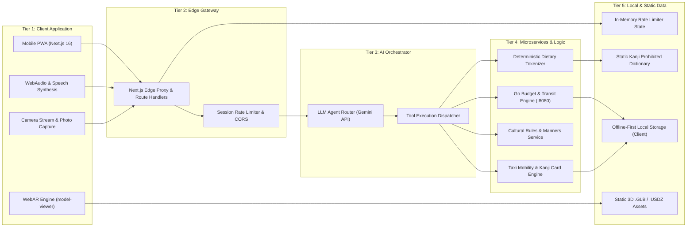
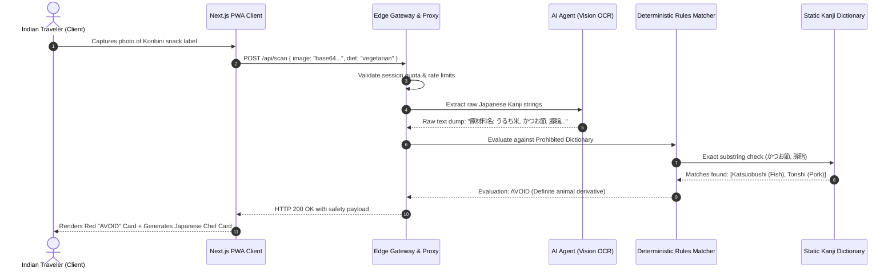

# Yatra Japan (TabiNavi)

> **Explore with WebAR, Navigate with Certainty, Travel with Zero Cultural Anxiety.**

[](https://nextjs.org/)
[](https://golang.org/)
[](https://www.docker.com/)
[](https://modelviewer.dev/)
[](#)

---

## 1. How to Run the Project

### Prerequisites
- Docker & Docker Compose **OR**
- Node.js (v20+), Go (v1.24+), and npm

---

### Step 1: Configure Environment Variables

Create a `.env` file in the repository root (`japan_hackathon/.env`):

```bash
# Copy the provided template
cp .env.example .env
```

Your `.env` file must contain:

```env
# Google Gemini API Key (Required for AI planning and OCR reading)
GEMINI_API_KEY=your_gemini_api_key_here

# Go Planner Service Configuration
PORT=8080

# Service URLs
BACKEND_URL=http://backend:8080
NEXT_PUBLIC_BACKEND_URL=http://localhost:8080

# Optional: Flight API Credentials (falls back to calibrated matrix if empty)
AMADEUS_CLIENT_ID=
AMADEUS_CLIENT_SECRET=
AMADEUS_ENV=test
```

---

### Step 2: Run with Docker Compose (Recommended)

To build and start all containers simultaneously:

```bash
docker compose up --build
```

This starts:
- **Web PWA (Next.js 16)**: `http://localhost:3000`
- **Go Planner Service**: `http://localhost:8080` (Health check: `http://localhost:8080/health`)
- **Mobile Metro Bundler (Expo 52)**: `http://localhost:8081`

To stop containers:
```bash
docker compose down
```

---

### Step 3: Run Services Individually (Manual Development)

If you prefer running services directly on your host machine without Docker:

#### 1. Go Backend Microservice
```bash
cd backend_go
go run cmd/server/main.go
# Server runs on http://localhost:8080
```

#### 2. Next.js Web Frontend
```bash
cd japan-saathi
npm install
npm run dev
# App runs on http://localhost:3000
```

#### 3. React Native Mobile App (Optional)
```bash
cd japan-saathi-mobile
npm install
npx expo start
```

---

## 2. Problem Diagnosis & Value Creation

### Competition Challenge
> *"How can Japan attract more travelers from India, and what would make Japan a top destination for Indian travelers?"*

### Strategic Imperative: Non-Discount Value Creation
Competing for Indian outbound tourism through price discounts or subsidies is economically unsustainable and counter to Japan's *Omotenashi* (hospitality) positioning. Instead, **Yatra Japan (TabiNavi)** creates asymmetric value by methodically eliminating the psychological barriers, cultural friction points, and logistical opacity that cause Indian travelers—especially families, vegetarians, and first-time solo explorers—to hesitate or default to Southeast Asian alternatives.

### The 5 Domains of Travel Friction vs. Yatra Japan Interventions

| Friction Domain | Core Obstacle for Indian Travelers | Yatra Japan Deterministic Solution |
| :--- | :--- | :--- |
| **1. Dietary Uncertainty** *(The "Hidden Dashi" Trap)* | Over 30% of Indian travelers follow strict Vegetarian, Jain, or Halal diets. Packaged konbini snacks and restaurant broths routinely conceal fish extract (*dashi*), pork stock, or animal gelatin written in complex Kanji. | **Deterministic Zero-ML OCR Scanner:** Real-time character extraction validated against a curated, exact-match Kanji blacklist with immediate SAFE, CAUTION, or AVOID verdicts. |
| **2. Social Etiquette Anxiety** *(Fear of Causing Offense)* | Fear of unintentionally violating strict unspoken Japanese customs (onsen bathing sequences, Shinto shrine bow-clap rituals, train quiet cabins, zero tipping). | **Situational Etiquette Decoders:** High-contrast visual cue cards broken down into 3-step action cards with bilingual audio pronunciations. |
| **3. Language & Mobility Disconnect** *(Last-Mile Navigation)* | Japanese taxi drivers rarely speak English or recognize Romanized street names. Translating specific destinations or route preferences creates severe stress. | **Two-Way Voice & Taxi Cards:** Spoken intent processing (Whisper STT in English/Hindi) outputting high-contrast, large-format Kanji driver cards with native browser SpeechSynthesis (TTS). |
| **4. Perceived Cost & Multi-Pass Confusion** *(Transit Opacity)* | Widespread belief that Japan is prohibitively expensive; acute confusion between regional rail passes vs. the national JR Pass, plus uncertainty over INR and JPY conversion. | **Central AI Agent & Currency Engine:** Tool-augmented budget calculation calculating true SmartEX point-to-point rail costs vs. passes in real-time INR and JPY without hallucinated numbers. |
| **5. Pre-Trip Cultural Distance** *(Stereotype Perception)* | Indian travelers frequently perceive Japan exclusively through neon-lit cyberpunk tropes, remaining unaware of deep spiritual ties (Saraswati / Benzaiten, Ganesha / Kangiten). | **Browser-Native WebAR & 360-degree VR:** Zero-install `<model-viewer>` living-room portals and 360-degree interactive heritage tours highlighting shared Indo-Japanese historical lineage. |

---

## 3. Solution Architecture & Key Features

### 1. WebAR & WebVR Spatial Portals
- **Living-Room WebAR (`<model-viewer>`):** Zero-install augmented reality directly within mobile Safari and Chrome. Travelers project life-sized Japanese heritage landmarks (Fushimi Inari Torii Gate, Five-Story Pagoda, E5 Series Shinkansen) onto their living room floor using standard WebXR, Scene Viewer (Android), and Quick Look (iOS `.usdz`).
- **360-degree Panoramic WebVR Bridge:** Interactive panoramic discovery powered by WebGL/A-Frame within an isolated iframe container. Bidirectional `postMessage` communication coordinates look-at raycasters with the parent PWA, displaying synchronized cultural context cards and regional ambient audio.

### 2. Central AI Travel Orchestrator
- **Deterministic Tool Calling:** Replaces unreliable free-form generative LLM text with strict function-calling schemas. The orchestrator calls dedicated computational microservices for budgeting, flight lookups, and transit routing.
- **Zero-Hallucination Math:** Flight pricing matrices (DEL/BOM to NRT/HND) and Shinkansen SmartEX rail fares are computed using deterministic integer arithmetic, guaranteeing identical pricing across runs.

### 3. Deterministic Dietary OCR Engine
- **Cloud Vision OCR + Exact-Match Japanese Blacklist:** Extracts raw label text from packaged convenience store snacks and cross-references tokens against a compiled Kanji dictionary containing over 70 prohibited animal derivatives and non-vegetarian seasonings.
- **Categorical Fallback:** Categorizes findings into *Definite*, *Potential Risk*, or *Safe Exception* (e.g., *kombu dashi* kelp stock), automatically generating translated Japanese Chef Cards for restaurant staff when manual verification is needed.

### 4. Mobility & Voice-Assisted Taxi Cards
- **Voice Intent Decoding:** Travelers hold a microphone trigger and speak naturally in English or Hindi. Spoken audio is processed to capture the traveler's intended action (e.g., requesting a toll expressway, paying via Suica, or giving directions).
- **Driver-Facing High-Contrast HUD:** Instantly renders large-format Japanese Kanji destination cards with official postal codes, landmarks, and phonetic phonemes designed for immediate legibility from the back seat of a cab.
- **Native Browser SpeechSynthesis:** Speaks courteous Japanese honorific phrases (*"Kosokudoro o tsukatte kudasai"*) directly to the driver with zero third-party latency.

---

## 4. High-Level Design (HLD)

### System Architecture Diagram



---

## 5. Low-Level Design (LLD)

### 5.1 End-to-End Execution Sequence Flow

The following sequence captures the full lifecycle of an Indian traveler capturing a food label, triggering deterministic OCR parsing, and receiving an actionable UI verdict.



---

### 5.2 Deterministic Kanji Ingredient Matcher (TypeScript)

The core food safety algorithm completely bypasses LLM text generation to ensure 100% deterministic, zero-hallucination evaluations:

```typescript
export interface ProhibitedTerm {
  kanji: string;
  romaji: string;
  english: string;
  category: "meat" | "fish" | "gelatin" | "alcohol" | "root_vegetable" | "onion_garlic";
  dangerLevel: "definite" | "risk" | "safe_exception";
}

export const DIETARY_DICTIONARY: ProhibitedTerm[] = [
  // Fish & Seafood Derivatives
  { kanji: "かつお", romaji: "katsuo", english: "Bonito fish", category: "fish", dangerLevel: "definite" },
  { kanji: "かつお節", romaji: "katsuobushi", english: "Dried bonito flakes", category: "fish", dangerLevel: "definite" },
  { kanji: "だし", romaji: "dashi", english: "Fish/meat stock", category: "fish", dangerLevel: "definite" },
  { kanji: "魚介エキス", romaji: "gyokai ekisu", english: "Seafood extract", category: "fish", dangerLevel: "definite" },

  // Meat Derivatives & Animal Fats
  { kanji: "豚肉", romaji: "butaniku", english: "Pork", category: "meat", dangerLevel: "definite" },
  { kanji: "豚脂", romaji: "tonshi", english: "Lard (pork fat)", category: "meat", dangerLevel: "definite" },
  { kanji: "牛肉", romaji: "gyuniku", english: "Beef", category: "meat", dangerLevel: "definite" },
  { kanji: "鶏肉", romaji: "toriniku", english: "Chicken", category: "meat", dangerLevel: "definite" },
  { kanji: "ゼラチン", romaji: "zerachin", english: "Gelatin", category: "gelatin", dangerLevel: "definite" },

  // Jain Restrictions (Root vegetables & bulbs)
  { kanji: "玉ねぎ", romaji: "tamanegi", english: "Onion", category: "onion_garlic", dangerLevel: "definite" },
  { kanji: "にんにく", romaji: "ninniku", english: "Garlic", category: "onion_garlic", dangerLevel: "definite" },

  // Safe Exceptions (Parsed first to prevent false flags)
  { kanji: "昆布だし", romaji: "kombu dashi", english: "Pure kelp stock", category: "fish", dangerLevel: "safe_exception" },
  { kanji: "椎茸だし", romaji: "shiitake dashi", english: "Mushroom stock", category: "fish", dangerLevel: "safe_exception" },
];

export function evaluateIngredients(
  rawOcrText: string,
  diet: "vegetarian" | "jain" | "halal"
): { verdict: "safe" | "caution" | "avoid"; matchedTerms: ProhibitedTerm[] } {
  // 1. Normalize OCR text: strip whitespaces and convert full-width katakana
  let sanitized = rawOcrText.replace(/\s+/g, "");

  // 2. Strip safe exceptions before scanning prohibited substrings
  const exceptions = DIETARY_DICTIONARY.filter(t => t.dangerLevel === "safe_exception");
  for (const ex of exceptions) {
    sanitized = sanitized.split(ex.kanji).join("");
  }

  // 3. Scan for exact prohibited token occurrences
  const matches: ProhibitedTerm[] = [];
  for (const term of DIETARY_DICTIONARY) {
    if (term.dangerLevel === "safe_exception") continue;

    if (sanitized.includes(term.kanji)) {
      if (diet === "vegetarian" && (term.category === "meat" || term.category === "fish" || term.category === "gelatin")) {
        matches.push(term);
      } else if (diet === "jain" && (term.category === "meat" || term.category === "fish" || term.category === "gelatin" || term.category === "onion_garlic" || term.category === "root_vegetable")) {
        matches.push(term);
      } else if (diet === "halal" && (term.category === "meat" || term.category === "alcohol" || term.category === "gelatin")) {
        matches.push(term);
      }
    }
  }

  if (matches.some(m => m.dangerLevel === "definite")) {
    return { verdict: "avoid", matchedTerms: matches };
  }
  if (matches.length > 0) {
    return { verdict: "caution", matchedTerms: matches };
  }
  return { verdict: "safe", matchedTerms: [] };
}
```

---

### 5.3 Bi-directional WebVR `postMessage` Event Interface

Communication between the host Next.js PWA and the sandboxed A-Frame WebVR iframe is maintained over a strongly-typed window message protocol:

```typescript
// Shared Event Types
export type WebVRMessage =
  | { type: "VR_HOTSPOT_HOVER"; landmarkId: string; heading: number }
  | { type: "VR_SCENE_LOADED"; ready: boolean; defaultFov: number }
  | { type: "PWA_SET_LOCATION"; landmarkId: string; coordinates: [number, number] }
  | { type: "PWA_TRIGGER_AUDIO"; audioUrl: string };

// 1. Host PWA: Listening for gaze triggers from the 360-degree VR scene
if (typeof window !== "undefined") {
  window.addEventListener("message", (event: MessageEvent<WebVRMessage>) => {
    if (!event.data || typeof event.data !== "object") return;

    if (event.data.type === "VR_HOTSPOT_HOVER") {
      const { landmarkId } = event.data;
      document.dispatchEvent(new CustomEvent("show-cultural-sheet", { detail: { landmarkId } }));
    }
  });
}

// 2. Host PWA: Dispatching camera orientation changes to WebVR iframe
export function navigateVRScene(iframeEl: HTMLIFrameElement, landmarkId: string, coordinates: [number, number]) {
  const payload: WebVRMessage = {
    type: "PWA_SET_LOCATION",
    landmarkId,
    coordinates,
  };
  iframeEl.contentWindow?.postMessage(payload, "*");
}
```

---

## 6. Repository Structure

```
japan_hackathon/
├── .env.example                     # Unified environment template
├── docker-compose.yml               # Multi-container local orchestrator
├── README.md                        # Project documentation & run guide
│
├── backend_go/                      # Go 1.24 Travel Budget & Planner Microservice
│   ├── cmd/server/main.go           # HTTP server, routing, and CORS preflight handling
│   ├── pkg/planner/planner.go       # Integer math budgeter (INR / JPY, SmartEX rail fares)
│   ├── Dockerfile                   # Multi-stage lightweight scratch container (<25MB)
│   └── go.mod                       # Go module dependencies
│
├── japan-saathi/                    # Next.js 16 Web-First Progressive Web App (PWA)
│   ├── src/
│   │   ├── app/                     # Next.js App Router
│   │   │   ├── api/scan/route.ts    # Deterministic dietary scan API handler
│   │   │   ├── api/taxi/listen/     # Multimodal voice intent listener
│   │   │   ├── chef/[diet]/         # Multilingual chef allergy cards (Japanese/English)
│   │   │   ├── manners/             # Situational cultural etiquette decoders
│   │   │   ├── place/[id]/          # Landmark guides & WebAR 3D living-room viewers
│   │   │   ├── plan/                # Central AI agent trip orchestrator & chat interface
│   │   │   ├── scan/                # Real-time dietary label scanner
│   │   │   ├── services/            # Curated services directory & currency converter
│   │   │   ├── taxi/[id]/           # High-contrast Japanese driver Kanji cards
│   │   │   ├── today/               # Daily itinerary dashboard & weather tracker
│   │   │   └── globals.css          # Nippon-iro 1930s Tourist Bureau design system
│   │   ├── components/              # Modular UI components (ModelViewer, TabBar, etc.)
│   │   ├── data/                    # Curated datasets (Services, Cultural Knowledge Base)
│   │   └── lib/
│   │       ├── diet/                # Deterministic Kanji dictionary & scanner engine
│   │       └── llm/                 # Gemini function-calling orchestrator
│   ├── public/                      # Static assets, WebAR .glb models, icons, and audio
│   ├── Dockerfile                   # Standalone Next.js production container
│   ├── next.config.ts               # Standalone output, Turbopack, and backend rewrites
│   └── package.json                 # Web dependencies
│
├── japan-saathi-mobile/             # React Native (Expo 52) Companion Application
│   ├── src/                         # Mobile components, native camera bindings, and offline state
│   ├── app.json                     # Standalone Android APK & iOS configuration
│   └── package.json                 # Mobile dependencies
│
└── docs/                            # Architectural deep-dives & feature documentation
    ├── feature_8_japan_essential_apps_and_services.md
    └── DEPLOYMENT_GUIDE.md
```

---

## License

Distributed under the MIT License. Developed for the Japan Tourism Innovation Hackathon.
