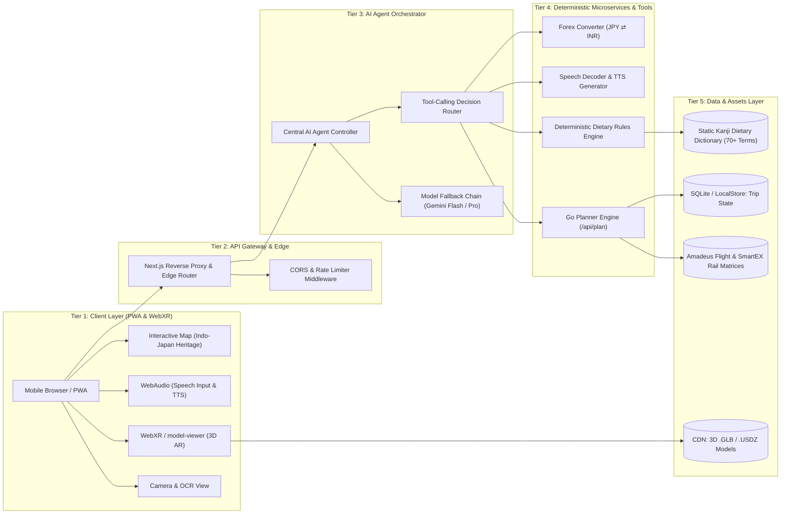
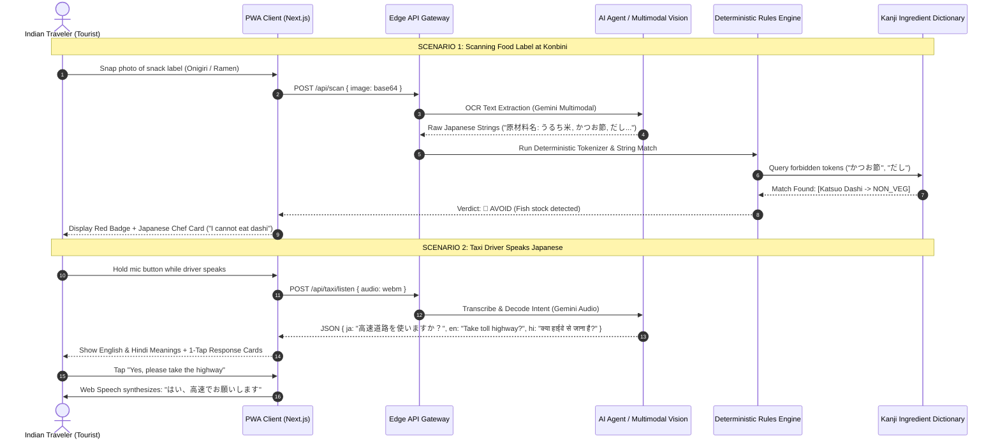

# Yātrā Japan (यात्रा Japan) · TabiNavi (旅ナビ)

> **"Explore with WebAR, Navigate with Certainty, Travel with Zero Cultural Anxiety."**

[](https://github.com/ansh0014/japan_hackathon/actions)
[](https://nextjs.org/)
[](https://golang.org/)
[](https://www.docker.com/)
[](https://modelviewer.dev/)
[](#)

---

## 1. Project Title & Executive Summary

**Yātrā Japan (TabiNavi)** is a browser-native Progressive Web App (PWA) and mobile platform engineered specifically to dissolve the structural friction points that deter Indian travellers from visiting Japan. Rather than competing through discount schemes or race-to-the-bottom pricing, Yātrā Japan creates asymmetric psychological and practical value:

1. **Pre-Trip Spatial Immersion:** Zero-download **WebAR/WebVR** portals projecting life-sized Japanese heritage landmarks (Torii gates, Pagodas, Shinkansen) straight into Indian living rooms.
2. **Tool-Augmented Central AI Agent:** An LLM orchestrator wired to deterministic pricing, real-time weather, and schedule tools that eliminates hallucinations in trip budgeting and railway routing.
3. **Deterministic Dietary Safety Engine:** A dual OCR-and-exact-match Japanese Kanji dictionary that instantly decodes packaged convenience store (konbini) snacks and restaurant menus for **Vegetarian, Jain, and Halal** dietary restrictions (preventing the "Hidden Dashi" trap).
4. **Situational Cultural Etiquette Decoder:** Step-by-step visual cue cards demystifying onsen etiquette, shrine worship sequences, and train rules to eliminate tourist anxiety.
5. **Two-Way Voice Taxi Mobility Engine:** Speech recognition in English/Hindi converting spoken intent into high-contrast Japanese driver cards with native browser speech synthesis (TTS) speaking polite Japanese to drivers.

---

## 2. Problem Statement & Root Cause Analysis

### The Core Challenge
> *"How can Japan attract more travelers from India, and what would make Japan a top destination for Indian travelers?"*

### The Core Constraint
**Value creation over price discounting.** Japan must be positioned not as a "budget alternative," but as an accessible, deeply welcoming, culturally aligned, and navigable destination for multi-generational Indian families, vegetarians, and first-time solo explorers.

```
┌────────────────────────────────────────────────────────────────────────┐
│                       ROOT CAUSE ANALYSIS MATRIX                       │
├───────────────────────────────┬────────────────────────────────────────┤
│ Friction Point                │ Real-World Impact                      │
├───────────────────────────────┼────────────────────────────────────────┤
│ 1. The Hidden Dashi Trap      │ Over 30% of Indian tourists follow     │
│    (Dietary Uncertainty)      │ strict Vegetarian or Jain diets.       │
│                               │ Hidden bonito (かつお), dashi (だし),    │
│                               │ or gelatin (ゼラチン) in seemingly     │
│                               │ vegetarian dishes causes food anxiety. │
├───────────────────────────────┼────────────────────────────────────────┤
│ 2. Social Etiquette Anxiety   │ Fear of offending locals due to strict │
│    (Omotenashi Disconnect)    │ unspoken norms: nude onsen rituals,    │
│                               │ bow-clap sequences at Shinto shrines,  │
│                               │ quiet commuter cars, and zero tipping. │
├───────────────────────────────┼────────────────────────────────────────┤
│ 3. Language & Mobility Gap    │ Japanese cab drivers rarely speak      │
│    (Last-Mile Transport)      │ English or read Romanized addresses.   │
│                               │ Indian tourists struggle to get to     │
│                               │ specific hotels or off-the-beaten-path │
│                               │ attractions.                           │
├───────────────────────────────┼────────────────────────────────────────┤
│ 4. Perceived Cost & Pass Maze │ Confusion between Regional rail passes │
│    (Transit Transparency)     │ vs. the national JR Pass, plus fear of │
│                               │ hidden costs and lack of INR clarity.  │
├───────────────────────────────┼────────────────────────────────────────┤
│ 5. Pre-Trip Cultural Distance │ India and Japan share deep historical  │
│    (Awareness Deficit)        │ roots (Benzaiten/Saraswati), yet most  │
│                               │ Indians perceive Japan solely as       │
│                               │ futuristic neon skylines.              │
└───────────────────────────────┴────────────────────────────────────────┘
```

---

## 3. Our Solution & MVP Architecture

```
                    ┌────────────────────────────────┐
                    │      YĀTRĀ JAPAN PLATFORM      │
                    └───────────────┬────────────────┘
                                    │
    ┌────────────────┬──────────────┼────────────────┬────────────────┐
    ▼                ▼              ▼                ▼                ▼
[Feature 1 & 2]  [Feature 3]    [Feature 4]      [Feature 5]      [Feature 6 & 7]
  WebAR & VR      Indo-Japan     Central AI       Situational      Dietary Engine
  Living-Room     Cultural Map    Agent &         Etiquette         & Taxi Voice
   Portals       & Shared Roots  Planner Tool      Decoder          Navigator
```

### Feature 1: WebAR 3D Living-Room Portals
- Zero-install, browser-based augmented reality leveraging `<model-viewer>` and WebXR.
- Projects scale 3D models (Fushimi Inari Torii Gate, Five-Story Pagoda, E5 Shinkansen) into the traveler's room on iOS (Quick Look `.usdz`) and Android (Scene Viewer `.glb`).
- Bridges psychological distance before purchasing flights.

### Feature 2: 360° WebVR Interactive Discovery
- Panoramic, touch-navigable 360° environments embedded via WebGL/A-Frame.
- Bidirectional `postMessage` protocol triggering contextual cultural cards and ambient audio when users look at key architectural landmarks.

### Feature 3: Indo-Japan Cultural Discovery Map
- Interactive map highlighting deep historical and spiritual ties between India and Japan.
- Curates syncretic deities: **Benzaiten (Saraswati)**, **Kangiten (Ganesha)**, **Bishamonten (Kubera)**, and **Daikokuten (Mahakala)**.
- Demystifies cultural reverence and builds immediate emotional resonance.

### Feature 4: Central AI Agent (Orchestrated Tool Calling)
- LLM agent (Google Gemini 2.5 Flash / Claude 3.5 Sonnet) operating exclusively with deterministic external tools.
- Real flight pricing matrices (DEL/BOM ⇄ NRT/HND) and Shinkansen SmartEX rail cost comparisons calculated through Go microservices rather than generative approximations.
- 100% reproducible, verifiable daily itineraries in Indian Rupees (INR) and Japanese Yen (JPY).

### Feature 5: Situational Cultural Rules & Etiquette Decoder
- Structured, bite-sized visual workflows:
  - **Onsen Bathing:** Step-by-step wash-before-soak rules, towel etiquette, tattoo regulations.
  - **Shrine vs. Temple:** "Bow twice, clap twice, bow once" at Shinto shrines vs. silent joined-palm prayer at Buddhist temples.
  - **Commuter Trains:** Backpack on front, silent phone etiquette, priority seat awareness.
  - **Dining & Tipping:** "Sumimasen" calls, table bill trays, and the zero-tipping rule.

### Feature 6: Zero-ML Deterministic Dietary Scanner
- Combines OCR text extraction with a hand-checked 70+ term Japanese dietary dictionary.
- Flagging tiers:
  - 🟢 **SAFE:** Verified 100% vegetarian, plant-based, or dashi-free.
  - 🟡 **CHECK / ASK STAFF:** Ambiguous ingredients (e.g., emulsifier, seasoning) with an auto-generated Japanese Chef Card.
  - 🔴 **AVOID:** Definite animal byproduct detected (fish extract, gelatin, lard, chicken stock).
- **"Choose Wisely" Sushi Card:** Recommends verified fish-free sushi alternatives (*Kappa Maki*, *Kanpyo Maki*, *Inari Sushi*).

### Feature 7: Taxi Mobility & Two-Way Speech
- Spoken audio recording via WebAudio MediaRecorder API.
- Multimodal audio interpretation decoding Japanese cab driver inquiries (*"Shall we take the toll expressway?"*, *"Cash or IC Card?"*).
- Dual outputs: Plain English explanation + Hindi translation for traveling parents/elders.
- 1-tap polite Japanese response buttons with native browser Speech Synthesis (TTS).
- High-contrast, full-screen Japanese destination cards (〒 address, Kanji name, pronunciation) readable from the taxi back seat.

---

## 4. High-Level Design (HLD)

### 4.1 System Architecture Diagram



### 4.2 User Journey & Data Flow: Dietary Scanner & Taxi Speech



---

## 5. Low-Level Design (LLD)

### 5.1 Database Schemas (SQL / DDL)

```sql
-- 1. User Profiles & Dietary Configuration
CREATE TABLE users (
    id TEXT PRIMARY KEY,
    created_at TIMESTAMP DEFAULT CURRENT_TIMESTAMP,
    dietary_preference TEXT CHECK(dietary_preference IN ('jain', 'vegetarian', 'halal', 'none')) NOT NULL,
    home_city TEXT DEFAULT 'DEL',
    preferred_language TEXT DEFAULT 'en'
);

-- 2. Itineraries & Cost Breakdowns
CREATE TABLE itineraries (
    id TEXT PRIMARY KEY,
    user_id TEXT REFERENCES users(id) ON DELETE CASCADE,
    title TEXT NOT NULL,
    duration_days INTEGER NOT NULL,
    travelers_count INTEGER NOT NULL,
    travel_style TEXT CHECK(travel_style IN ('budget', 'comfort', 'fast')) NOT NULL,
    total_cost_inr INTEGER NOT NULL,
    total_cost_jpy INTEGER NOT NULL,
    flight_cost_inr INTEGER NOT NULL,
    rail_savings_inr INTEGER NOT NULL,
    created_at TIMESTAMP DEFAULT CURRENT_TIMESTAMP
);

-- 3. Deterministic Prohibited Ingredient Dictionary
CREATE TABLE food_prohibited_terms (
    id INTEGER PRIMARY KEY AUTOINCREMENT,
    kanji TEXT NOT NULL UNIQUE,
    romaji TEXT NOT NULL,
    english_name TEXT NOT NULL,
    category TEXT CHECK(category IN ('meat', 'fish', 'gelatin', 'alcohol', 'root_vegetable', 'onion_garlic')) NOT NULL,
    violates_jain BOOLEAN NOT NULL DEFAULT 1,
    violates_veg BOOLEAN NOT NULL DEFAULT 1,
    violates_halal BOOLEAN NOT NULL DEFAULT 0,
    danger_level TEXT CHECK(danger_level IN ('definite', 'risk', 'safe_exception')) NOT NULL
);

-- Sample Seed Entries
INSERT INTO food_prohibited_terms (kanji, romaji, english_name, category, violates_jain, violates_veg, violates_halal, danger_level) VALUES
('かつお節', 'katsuobushi', 'Bonito fish flakes', 'fish', 1, 1, 0, 'definite'),
('豚肉', 'butaniku', 'Pork', 'meat', 1, 1, 1, 'definite'),
('ゼラチン', 'zerachin', 'Gelatin', 'gelatin', 1, 1, 1, 'definite'),
('だし', 'dashi', 'Fish/meat soup stock', 'fish', 1, 1, 0, 'definite'),
('玉ねぎ', 'tamanegi', 'Onion', 'onion_garlic', 1, 0, 0, 'definite'),
('にんにく', 'ninniku', 'Garlic', 'onion_garlic', 1, 0, 0, 'definite'),
('昆布だし', 'kombu dashi', 'Pure Kelp Stock', 'fish', 0, 0, 0, 'safe_exception');

-- 4. Situational Cultural Rules
CREATE TABLE cultural_rules (
    id TEXT PRIMARY KEY,
    category TEXT CHECK(category IN ('onsen', 'shrine', 'train', 'dining', 'general')) NOT NULL,
    step_number INTEGER NOT NULL,
    title_en TEXT NOT NULL,
    instruction_en TEXT NOT NULL,
    instruction_hi TEXT NOT NULL,
    kanji_stamp TEXT NOT NULL
);
```

### 5.2 Deterministic Dietary Engine Logic

```typescript
export interface IngredientMatch {
  kanji: string;
  romaji: string;
  english: string;
  category: string;
  dangerLevel: "definite" | "risk" | "safe_exception";
}

export type Verdict = "safe" | "unsure" | "avoid";

export function evaluateDietSafety(
  rawOcrText: string,
  userDiet: "jain" | "vegetarian" | "halal",
  dictionary: IngredientMatch[]
): { verdict: Verdict; matchedFlags: IngredientMatch[]; reason: string } {
  const normalized = rawOcrText.replace(/\s+/g, "");
  const matchedFlags: IngredientMatch[] = [];

  // 1. Process safe exceptions first (e.g. 昆布だし - pure kelp stock)
  const safeExceptions = dictionary.filter(d => d.dangerLevel === "safe_exception");
  let sanitizedText = normalized;
  for (const item of safeExceptions) {
    sanitizedText = sanitizedText.split(item.kanji).join("");
  }

  // 2. Exact string search against prohibited terms
  for (const item of dictionary) {
    if (item.dangerLevel === "safe_exception") continue;

    if (sanitizedText.includes(item.kanji)) {
      if (userDiet === "jain" && (item.category === "root_vegetable" || item.category === "onion_garlic")) {
        matchedFlags.push(item);
      } else if (userDiet === "vegetarian" && (item.category === "fish" || item.category === "meat" || item.category === "gelatin")) {
        matchedFlags.push(item);
      } else if (userDiet === "halal" && (item.category === "meat" || item.category === "alcohol" || item.category === "gelatin")) {
        matchedFlags.push(item);
      }
    }
  }

  // 3. Return zero-hallucination deterministic verdict
  if (matchedFlags.some(f => f.dangerLevel === "definite")) {
    return {
      verdict: "avoid",
      matchedFlags,
      reason: `Definite non-compliant ingredient found: ${matchedFlags.map(f => f.english).join(", ")}`
    };
  }

  if (matchedFlags.length > 0) {
    return {
      verdict: "unsure",
      matchedFlags,
      reason: "Potential hidden animal derivatives detected. Use chef card."
    };
  }

  return {
    verdict: "safe",
    matchedFlags: [],
    reason: "Zero non-compliant ingredients detected in dictionary."
  };
}
```

### 5.3 Agent Tool Definitions (JSON Schema)

```json
{
  "$schema": "https://json-schema.org/draft/2020-12/schema",
  "tools": [
    {
      "name": "plan_budget_and_flights",
      "description": "Calculates flight fares, individual Shinkansen SmartEX rail costs, hotel estimates, and food costs in both INR and JPY without hallucinated numbers.",
      "parameters": {
        "type": "object",
        "properties": {
          "departure_city": { "type": "string", "enum": ["DEL", "BOM", "BLR", "MAA"] },
          "duration_days": { "type": "integer", "minimum": 3, "maximum": 21 },
          "travelers_count": { "type": "integer", "minimum": 1, "maximum": 10 },
          "travel_style": { "type": "string", "enum": ["budget", "comfort", "fast"] },
          "dietary_preference": { "type": "string", "enum": ["jain", "vegetarian", "halal", "none"] }
        },
        "required": ["departure_city", "duration_days", "travelers_count", "travel_style"]
      }
    },
    {
      "name": "generate_taxi_card",
      "description": "Produces a high-contrast, large-format Kanji destination card for Japanese taxi drivers.",
      "parameters": {
        "type": "object",
        "properties": {
          "destination_name": { "type": "string" },
          "japanese_address": { "type": "string" },
          "postal_code": { "type": "string" },
          "driver_notes_ja": { "type": "string" }
        },
        "required": ["destination_name", "japanese_address"]
      }
    }
  ]
}
```

### 5.4 WebAR & WebVR Technical Integration

```html
<!-- WebAR Integration (Zero-Install Spatial Anchor) -->
<model-viewer
  src="/models/fushimi_torii.glb"
  ios-src="/models/fushimi_torii.usdz"
  ar
  ar-modes="webxr scene-viewer quick-look"
  ar-scale="auto"
  camera-controls
  touch-action="pan-y"
  shadow-intensity="1.2"
  exposure="1.0"
  alt="3D Augmented Reality Model of Japanese Shrine Gate"
  style="width: 100%; height: 420px; background-color: transparent;"
>
  <button slot="ar-button" class="ar-launch-button">
    Tap to View in Your Room
  </button>
</model-viewer>
```

```javascript
// WebVR Panoramic Iframe postMessage Communication Protocol
const vrFrame = document.getElementById("aframe-vr-view");

// Host Page Listening to Look-At Events from WebGL Scene
window.addEventListener("message", (event) => {
  if (event.origin !== "https://vr.japansaathi.com") return;

  const { type, landmarkId, audioNarration } = event.data;
  if (type === "HOTSPOT_FOCUSED") {
    // Dynamically show the Indo-Japanese cultural synergy modal
    showCulturalModal(landmarkId);
    if (audioNarration) {
      playCulturalAudio(audioNarration);
    }
  }
});

// Triggering VR Teleportation from Host UI
function teleportVrTo(coordinate) {
  vrFrame.contentWindow.postMessage({
    action: "NAVIGATE_TO",
    position: coordinate
  }, "https://vr.japansaathi.com");
}
```

---

## 6. Implementation & Hackathon Viability

### 6.1 Tech Stack Table

| Layer | Technologies Selected | Rationale & Trade-offs |
| :--- | :--- | :--- |
| **Frontend Framework** | **Next.js 16 (App Router, Turbopack)** | Server Components for instant initial paint, standalone output for Docker, fast client routing. |
| **Mobile & PWA** | **React Native (Expo 52) / PWA** | Web-first with progressive mobile native builds (`.apk`), offline service workers for subway tunnels. |
| **Design Language** | **Tailwind CSS v4 (`nippon-iro` palette)** | 1930s Japan Tourist Bureau washi paper aesthetic; zero cartoon emojis; strict dark/light WCAG AA contrast. |
| **3D / Spatial AR** | **Google `<model-viewer>` & WebXR** | Native WebAR without third-party app installations; automatic iOS ARKit QuickLook and Android ARCore fallback. |
| **Backend Services** | **Go (Golang 1.24) Microservice** | Sub-millisecond travel budget matrix calculation, memory-efficient Docker image (<25MB), high concurrency. |
| **AI Orchestration** | **Google Gemini 2.5 Flash / Claude 3.5** | High token throughput, multimodal audio/vision support, deterministic tool-calling protocol. |
| **Dietary OCR Engine** | **Cloud Vision + Local Tokenizer** | Eliminates hallucination risk by enforcing string-level dictionary lookups on OCR tokens. |
| **Audio & Speech** | **WebAudio API + Browser TTS** | Client-side low-latency speech synthesis; serverless audio streaming without third-party voice subscription overhead. |

---

### 6.2 Why Deterministic Tools Outperform Pure LLM Prompts

```
┌────────────────────────────────────────────────────────────────────────┐
│                   DETERMINISTIC TOOLS VS. PURE PROMPTS                 │
├──────────────────────────┬─────────────────────────────────────────────┤
│ Pure Generative Prompts  │ ❌ Hallucinates train costs and rail rules. │
│                          │ ❌ Marks "dashi" as safe if prompted softly.│
│                          │ ❌ Miscalculates INR ⇄ JPY conversion rates.│
├──────────────────────────┼─────────────────────────────────────────────┤
│ Tool-Augmented Solution  │ ✅ Exact integer math for flight and rail.  │
│ (Yātrā Japan Engine)     │ ✅ 100% dictionary match on Kanji tokens.   │
│                          │ ✅ Pixel-perfect, high-contrast driver cards│
│                          │    that Japanese taxi drivers can read.     │
└──────────────────────────┴─────────────────────────────────────────────┘
```

---

### 6.3 Go-To-Market (GTM) & Distribution Strategy

1. **The Japan eVisa Approval Integration:**
   - Japan recently introduced electronic visas for Indian tourists. 
   - **Distribution Hook:** Partner with the Japan National Tourism Organization (JNTO) to place a verified QR code link to Yātrā Japan on eVisa issuance confirmation PDFs.
2. **Indian OTA Checkout Partnerships:**
   - Integrations at checkout on platforms like **MakeMyTrip**, **EaseMyTrip**, and **Cleartrip** when an Indian traveler books flights to Tokyo, Osaka, or Nagoya.
3. **Airport Arrival Touchpoints:**
   - Physical posters at Narita, Haneda, and Kansai Airport immigration arrival corridors providing instant QR onboarding before travelers purchase their train tickets.

---

### 6.4 Key Performance Indicators (KPIs) & Evaluation

| Success Metric | Target Benchmark | Measurement Method |
| :--- | :--- | :--- |
| **Dietary Confidence Index** | > 98% false-negative avoidance | Zero reported non-veg ingestion among tested vegetarian/Jain user cohorts. |
| **Time-to-Taxi Dispatch** | < 15 seconds | Time taken from entering cab to driver nodding understanding of destination. |
| **Regional Dispersion** | +35% visits outside Tokyo/Kyoto | Itineraries successfully guiding tourists to Kanazawa, Nagano, and Takayama. |
| **Pre-Trip Engagement** | > 3.5 minutes per AR session | User dwell time exploring 3D landmarks prior to booking travel. |

---

## 7. Quickstart & Local Setup

### Prerequisites
- Node.js `v20.x` or higher
- Go `v1.24` or higher
- Docker & Docker Compose

### 1. Clone & Configure Environment
```bash
git clone https://github.com/ansh0014/japan_hackathon.git
cd japan_hackathon

# Copy unified environment configuration
cp .env.example .env
# Edit .env and insert your free Gemini API key
```

### 2. Run Entire Stack via Docker
```bash
# Starts Go Backend (:8080), Next.js Web (:3000), and Mobile Service (:8081)
docker compose up --build
```

### 3. Run Manually (Local Development)
```bash
# Terminal 1: Run Go Planner Backend
cd backend_go
go run cmd/server/main.go

# Terminal 2: Run Next.js Web App
cd japan-saathi
npm install
npm run dev
```

Visit **`http://localhost:3000`** in your browser.

---

## License

Distributed under the MIT License. Developed for the Japan Tourism Innovation Hackathon.
